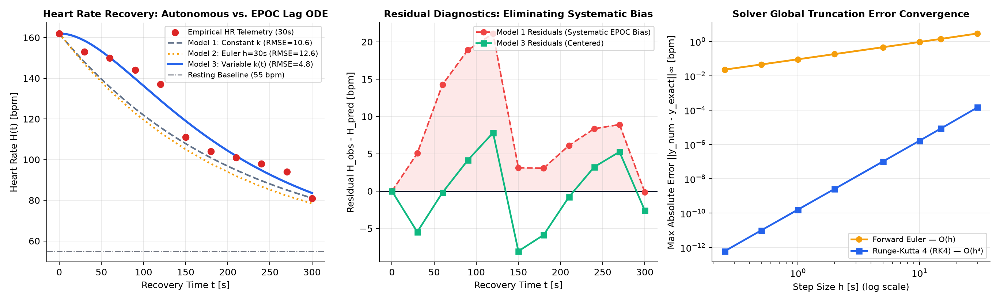

# Non-Autonomous Differential Equations & Numerical Solvers for Biometric Recovery

**Author:** Martin Dutang — *CentraleSupélec & McGill University (Bachelor of Global Engineering)*  
**Stack:** `Python` · `NumPy` · `SciPy` · `Matplotlib` · `Numerical Analysis (ODEs)`

---

## Overview

Collected during cross-country distance training ($H_0 = 162\text{ bpm}$, resting baseline $H_r = 55\text{ bpm}$), post-exercise heart rate recovery (HRR) is classically approximated via Newton's Law of Cooling. Through residual diagnostics and numerical step-size analysis, this repository demonstrates why constant-coefficient exponential decay systematically under-predicts early cardiac frequency due to **Excess Post-Exercise Oxygen Consumption (EPOC)** and delayed parasympathetic reactivation—and resolves that bias with a **non-autonomous variable-coefficient ODE**.



---

## Three-Stage Mathematical Progression

### 1. Autonomous Exponential Model & Residual Bias

$$
\frac{dH}{dt} = -k(H - H_r) \implies H(t) = 55 + 107e^{-kt}
$$

Log-linearized ordinary least squares ($\ln(H - 55) = -kt + \ln 107$) yields $k \approx 0.0047\text{ s}^{-1}$ with $R^2 = 0.947$, yet residual inspection exposes strictly positive errors across $30 \le t \le 270\text{ s}$ ($\text{RMSE} = 10.62\text{ bpm}$).

### 2. Numerical Integration & Truncation Error Scaling

Benchmarks Forward Euler — $\mathcal{O}(h)$ global error at $h = 30\text{ s}$ vs. $h = 1\text{ s}$ — against classical 4th-order Runge-Kutta (RK4) with $\mathcal{O}(h^4)$ global accuracy, verifying theoretical convergence slopes across two orders of magnitude in step size.

### 3. Non-Autonomous EPOC Reactivation ODE

Models parasympathetic nervous system (PNS) engagement via time-varying efficiency $k(t) = k_{\max}(1 - e^{-\lambda t})$:

$$
\frac{dH}{dt} = -k_{\max}\left(1 - e^{-\lambda t}\right)(H - H_r) \implies H(t) = H_r + (H_0 - H_r)\exp\left(-k_{\max}t - \frac{k_{\max}}{\lambda}\left(e^{-\lambda t} - 1\right)\right)
$$

Calibrating $(k_{\max} = 0.0056\text{ s}^{-1}, \lambda = 0.0155\text{ s}^{-1})$ via nonlinear least squares eliminates early-phase systematic bias and reduces overall error from **$10.62\text{ bpm}$ to $4.80\text{ bpm}$** (**55% RMSE reduction**).

---

## Quick Start

```bash
pip install -r requirements.txt
python3 recovery_models.py
python3 -m unittest test_solvers.py
```
